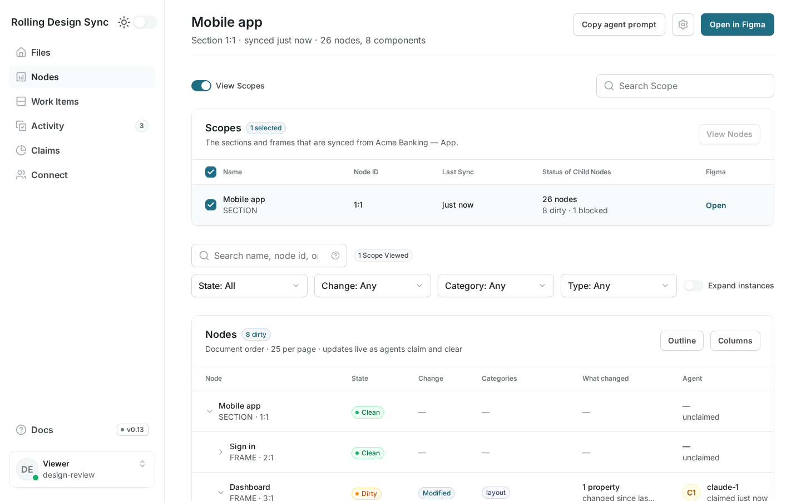
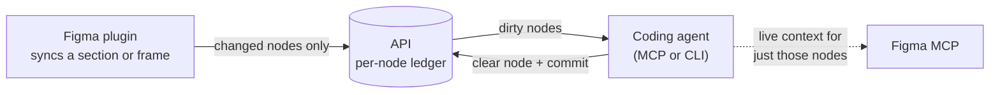
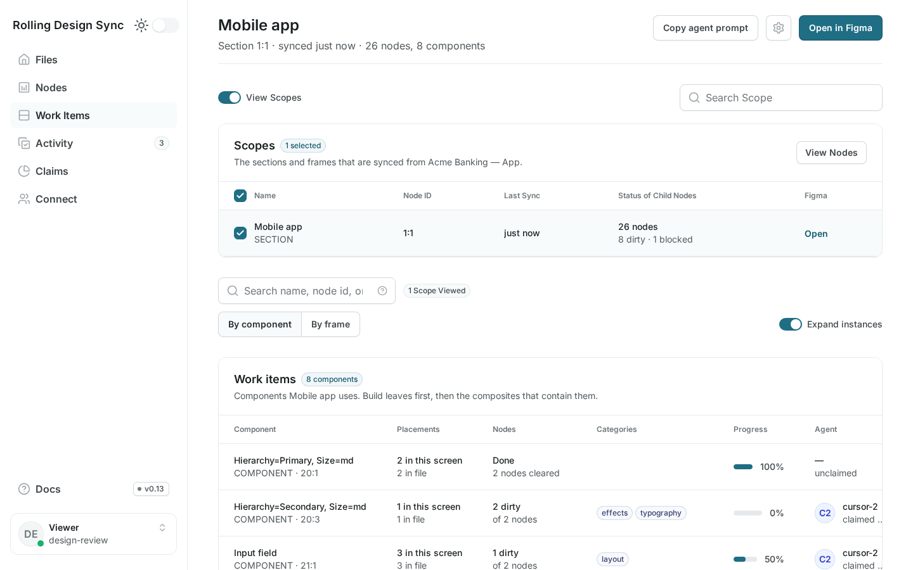
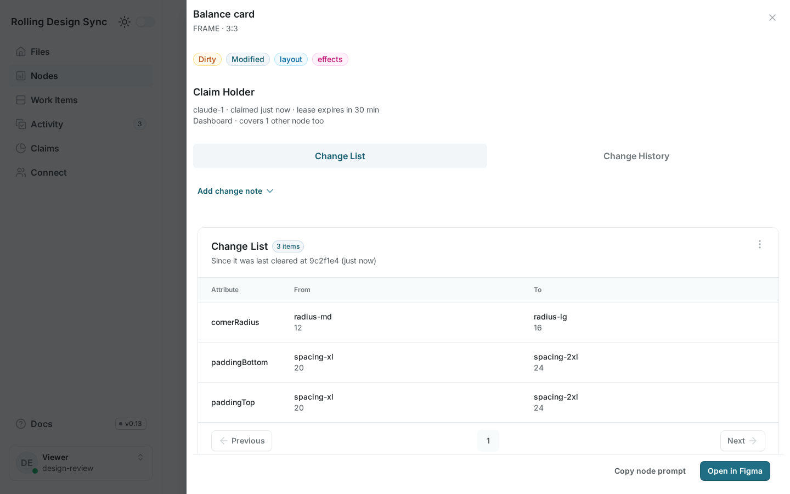
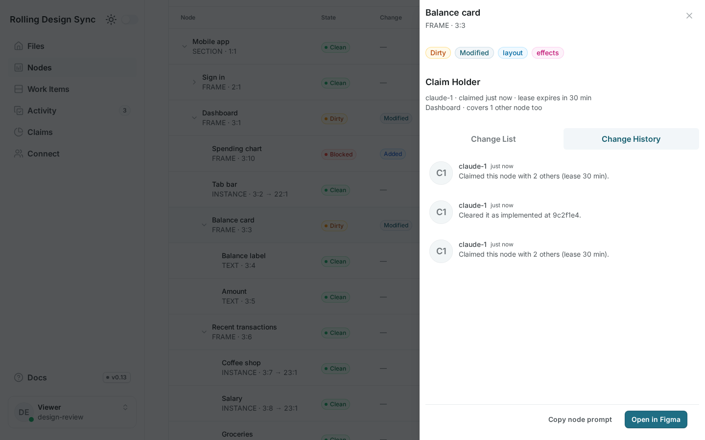
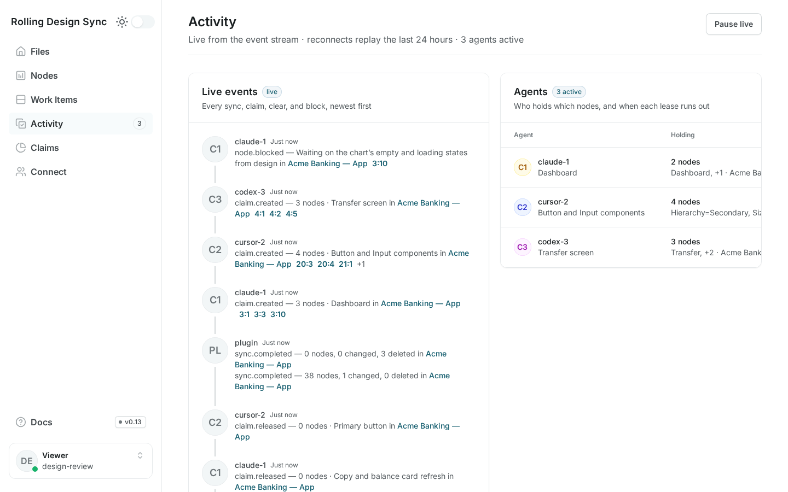
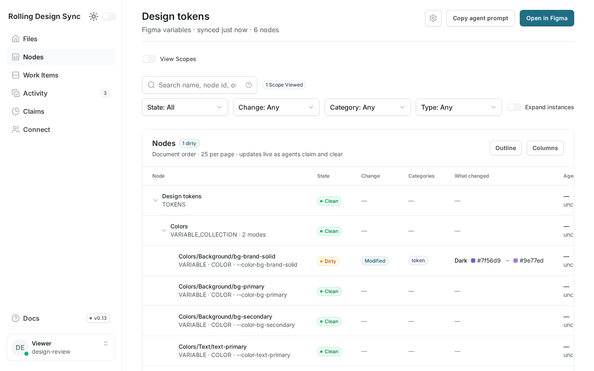
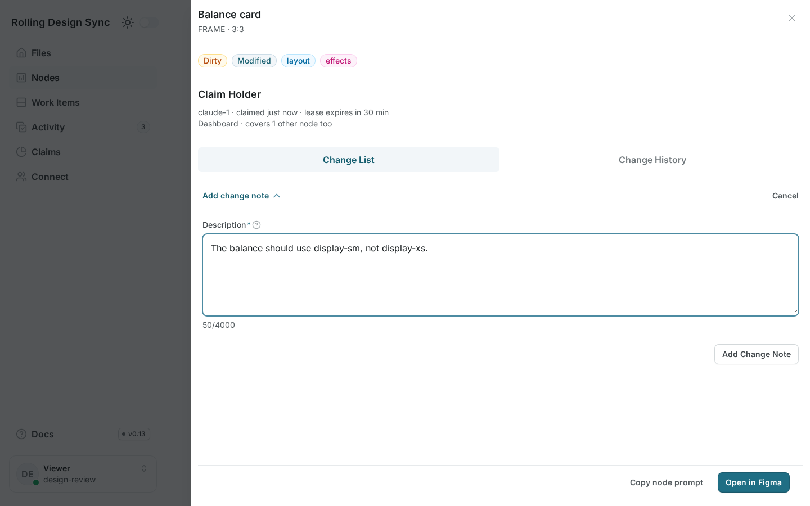
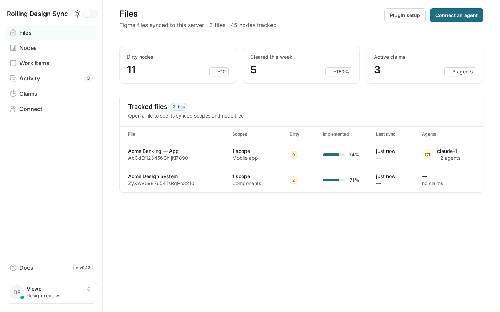
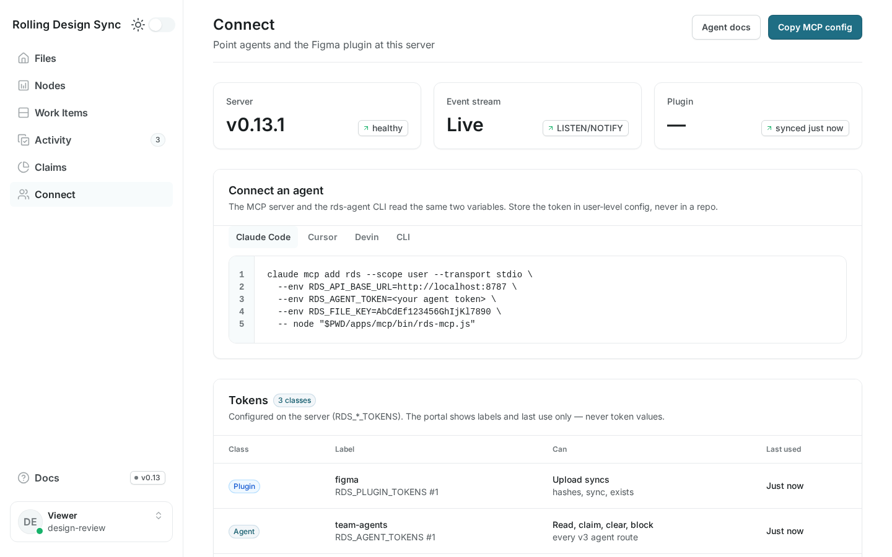

# Rolling Design Sync

**Tell your coding agent exactly which parts of a Figma design aren't built yet.**

[](https://github.com/deven-bryant/rolling-design-sync/actions/workflows/ci.yml)
[](https://github.com/deven-bryant/rolling-design-sync/actions/workflows/e2e.yml)
[](LICENSE)
[](apps/api/LICENSE.md)

Rolling Design Sync is a per-node **design-implementation ledger** for Figma. A
Figma plugin records what the design says, coding agents mark nodes as
implemented once the code matches, and what's left is exactly the design work
that hasn't been built — node by node, property by property.

> **Status: 0.13 beta.** It works end to end, but the API, plugin protocol,
> MCP tools and CLI may still change between minor releases until 1.0. What's promised, and when, is in the
> [compatibility policy](docs/compatibility.md).

**[Quickstart →](docs/quickstart.md)** from a clean machine to an agent clearing
its first Figma changes.



## Why

Asking an agent to "implement this Figma frame" works the first time. After
that it breaks down:

- **Agents start cold.** They re-scan the whole frame, get the big structure
  right, and quietly drop details.
- **Figma has no "what changed" API.** Webhooks tell you *a file* changed, not
  which nodes or properties.
- **The real question is "what changed since the code caught up?"** — not
  "since the last version", and without edits that were made and then reverted.

Rolling Design Sync answers that per node, so an agent only fetches design
context for the handful of nodes that actually need work.

## How it works



1. **Sync.** The plugin hashes every node in the selected scope and uploads only
   the ones that changed.
2. **Queue.** A node is **dirty** when its current hash differs from the hash an
   agent last implemented.
3. **Clear.** After updating the code, the agent clears the node with the hash it
   read and the commit SHA. That becomes the node's new baseline.

What that gets you:

- **No stale work.** A clear comes back `stale` if the design changed after the
  agent read it, so a newer edit is never marked done.
- **Parallel agents.** Agents lease nodes before building them, so several can
  share one file without doing the same work twice.
- **Reverts clean themselves up.** A node edited back to its implemented state
  stops being dirty.
- **Any Figma plan.** Variables, styles, and rich text are read by the plugin —
  no Enterprise-only APIs, no REST rate limits.
- **Components, not copies.** Changing a main component dirties the main, not
  every instance. Fix the coded component once and every screen follows.
- **Library components when you want them.** A per-file setting decides whether
  the plugin also tracks main components from team libraries; with it off,
  instances keep their component reference and the result says how many were
  skipped.
- **Every mode of every token.** Variables used by the synced layers, the
  file's local variables and their aliases are tracked as tokens with each
  mode's value, so a library's Dark-mode edit shows up as work on that token.
- **Already-built screens aren't new work.** When a sync would add many
  never-seen layers, the plugin asks whether the code already matches them
  before uploading.
- **Design tokens.** Figma variables are tracked too, mode by mode: change a
  token's Dark value in the library and that token — not every layer using it —
  comes back as work, with its code name and how many layers use it.
- **Notes when the build is off.** Spot something that doesn't match the
  design? Add a note on the node in the portal — anyone signed in can. The
  node comes back as **Requested** work; the agent reads the note, fixes the
  code and clears it, which resolves the note.
- **Works with your agent.** A local MCP server for Claude Code, Cursor and other
  MCP hosts, and a zero-dependency CLI for anything with a shell.

## The portal

The API serves a browser portal at `/ui`. Viewers read and add notes where
the build doesn't match the design; agents can also block nodes and release
claims. Everything updates live as agents claim and clear.
Select one or several scopes (sections or frames) to work on: the node tree,
the work items and the copied agent prompt cover all of them. The portal
follows your system's light or dark setting; the sidebar toggle overrides it.
Each file's **File settings** drawer (agents) switches **Track library
components**: off when your code gets library components from a package —
they then show as references, not work.

| | |
|---|---|
|  **Work items** — changes grouped by component, with progress, so the shared pieces get built first; search nodes and expand instances like the node tree. A deleted screen that was built is one **Removed** item listing the components it used and which are still placed elsewhere; library components are badged and link to their library file. |  **Change List** — each changed property, from what was built to what the design says now, design tokens included. |
|  **Change History** — every claim, clear and block on a node, with the commit that built it. |  **Activity** — everything that happened in your files, live; **Claims** shows who holds what right now. |
|  **Design tokens** — collections and tokens like any scope; each changed mode reads at a glance with color swatches, and a token's drawer shows its code name and how many layers use it. |  **Notes** — say what doesn't match the design on any node; it comes back as **Requested** work, and the agent's clear resolves the note. |
|  **Files** — every tracked file with what's left to build, and the week's trend: nodes cleared vs the week before, net newly dirty. |  **Connect** — copy-paste setup for Claude Code, Cursor, Devin and the CLI. |

The screenshots are generated from a seeded demo with
`npm run screenshots` in [`tests/e2e-portal`](tests/e2e-portal/screenshots.spec.js).

## Built with its own queue

The portal above was built from its Figma design through Rolling Design Sync
itself: the design was synced with the plugin, and coding agents worked the
queue — claiming work items so parallel agents didn't collide, building against
each node's changes, and clearing nodes with the commits that implemented them.
Design tweaks after that came back as just the nodes they touched.

## Install

| Way | Status |
|---|---|
| **Clone the repository** and run `docker compose up -d` | Available — the [quickstart](docs/quickstart.md) path |
| **npm packages** — [`@rolling-design-sync/mcp`](https://www.npmjs.com/package/@rolling-design-sync/mcp) (`npx @rolling-design-sync/mcp`), [`@rolling-design-sync/agent-cli`](https://www.npmjs.com/package/@rolling-design-sync/agent-cli) (`npx @rolling-design-sync/agent-cli`), [`@rolling-design-sync/core`](https://www.npmjs.com/package/@rolling-design-sync/core) | Available |
| **Container image** on GHCR ([`ghcr.io/deven-bryant/rolling-design-sync`](https://github.com/deven-bryant/rolling-design-sync/pkgs/container/rolling-design-sync)) | Available — `docker run` in the [quickstart](docs/quickstart.md) |

The MCP server and the CLI also run straight from a checkout
(`node apps/mcp/bin/rds-mcp.js`, `node scripts/rds-agent.js`).
[docs/agents.md](docs/agents.md) sets them up for Claude Code, Cursor and Devin,
and has the recipes: what's in a screen, what to build first, the clear loop,
and claims for parallel agents.

## Self-hosting

Self-hosting is the supported way to run Rolling Design Sync. The
[quickstart](docs/quickstart.md) runs it on one machine with Docker; for a team,
run the same API against Postgres.

### Running it for a team

The Docker setup is for **one machine**: it only accepts requests addressed to
`localhost`. For a team or production, run the API against **Postgres** (with
the `ltree` extension; Supabase works) on any host that runs a long-lived Node
process — Railway, Render, Fly, or a VM:

1. Apply every file in `supabase/migrations/`, in order.
2. Generate strong tokens: `node -e "console.log(require('crypto').randomBytes(32).toString('hex'))"`.
3. Start the API with `DATABASE_URL`, `RDS_PLUGIN_TOKENS`, and
   `RDS_AGENT_TOKENS` set (`npm start -w @rolling-design-sync/api`). For the
   portal, also set `RDS_VIEWER_TOKENS` and `RDS_SESSION_SECRET`.
4. Add your API's origin to `networkAccess.allowedDomains` in
   `apps/figma-plugin/manifest.json`.

[docs/setup.md](docs/setup.md) walks through each step, including Supabase and
running local mode without Docker.

#### Configuration

| Variable | Default | Purpose |
|---|---|---|
| `DATABASE_URL` | — | Postgres connection string (team / production) |
| `RDS_PLUGIN_TOKENS` | — | Comma-separated tokens for the plugin (upload routes only) |
| `RDS_AGENT_TOKENS` | — | Comma-separated tokens for agents (queue routes only) |
| `RDS_VIEWER_TOKENS` | — | Comma-separated read-only tokens (portal and dashboards) |
| `RDS_SESSION_SECRET` | — | Signs portal session cookies (required with `DATABASE_URL`; generated in local mode) |
| `PORT` | `8787` | Listen port |
| `HOST` | `0.0.0.0` | Listen address (`127.0.0.1` when `RDS_STORE` is set) |
| `RDS_STORE` | — | `local` (embedded, persistent) or `memory` (throwaway) instead of Postgres |
| `RDS_DATA_DIR` | `./data` | Local-mode data directory (`/data` in the container) |
| `RDS_CLAIM_TTL_SECONDS` | `900` | How long an agent's lease on a node lasts |
| `RDS_BODY_LIMIT_BYTES` | 64 MiB | Maximum request body |
| `PGSSLMODE` | — | `disable` for a local Postgres without TLS |
| `RDS_LISTEN_URL` | `DATABASE_URL` | Direct (non-pooler) Postgres URL for live events |
| `RDS_EVENT_REPLAY_HOURS` | `24` | How far back an event stream replays on reconnect |
| `RDS_EVENT_RETENTION_DAYS` | `30` | How long events are kept |

#### Security model

- **Two token classes.** A plugin token can only upload; an agent token can only
  read and clear. A leaked one can't do the other's job.
- **Local mode stays local.** The container publishes its port on `127.0.0.1`
  only, and local mode rejects requests addressed to any other host or coming
  from web pages. It runs as a non-root user with a read-only filesystem apart
  from its data volume.

## Hosted version

Rather not run a server? A hosted version is planned. Join the waitlist at
**[rollingdesignsync.com](https://rollingdesignsync.com/#waitlist)**.
Self-hosting stays fully supported.

## API

The API is v3: file-scoped, filterable and pageable, with the property-level
diff of each node against what was built. Agent routes take an agent token
(`Authorization: Bearer <agent token>`; a viewer token reads every `GET`), the
plugin routes a plugin token, and `/v3/openapi.json` none.

| Route | Purpose |
|---|---|
| `GET /v3/files` | Tracked files with counts and last sync |
| `GET /v3/files/{fileKey}` | One file's counts |
| `GET /v3/files/{fileKey}/scopes` | Synced roots with their last sync counts |
| `GET /v3/files/{fileKey}/nodes` | Filtered, paged node listing (`dirty` by default) |
| `GET /v3/files/{fileKey}/nodes/{nodeId}` | One node: changes, claim, history, subtree counts |
| `POST /v3/files/{fileKey}/clear` | Mark nodes implemented, hash-guarded per item |
| `POST /v3/files/{fileKey}/claims` | Lease nodes to a worker; `…/claims/{claimId}/renew`, `DELETE …/claims/{claimId}` |
| `POST /v3/files/{fileKey}/nodes/{nodeId}/block` | Mark a node that can't be built; `…/unblock` undoes it |
| `GET /v3/files/{fileKey}/summary` | Counts of what changed, by state, category, type and frame |
| `GET /v3/files/{fileKey}/work` | Changes grouped into work items (per component or frame) |
| `GET /v3/files/{fileKey}/events` | Activity log, as a page or a live event stream |
| `GET /v3/insights/trends` | Nodes cleared and newly dirtied this week vs the last, per file |
| `GET /v3/resolve?url=` | Figma link → `{ fileKey, nodeId }` |
| `GET /v3/files/{fileKey}/hashes` | Plugin: stored hashes for a subtree |
| `POST /v3/files/{fileKey}/sync` | Plugin: upsert changed nodes, tombstone deleted ones |
| `POST /v3/files/{fileKey}/exists` | Plugin: which nodes are stored (and which are stale) |
| `GET /v3/openapi.json` | OpenAPI 3.1 spec (no token) |
| `GET /health` | Liveness check (no token) |

Node ids may be written `1:2` or `1-2`; `under` takes one or several,
comma-separated (`under=1-2,5-1`), for the union of their subtrees. Any file route takes `?url=<figma link>`
in place of the key: `/v3/files/-/nodes?url=…` lists the subtree of the linked
node.

```bash
curl -s "$RDS_API_URL/v3/files/AbC123/nodes?under=1-2&category=layout" \
  -H "Authorization: Bearer $RDS_AGENT_TOKEN"
```

```json
{
  "fileKey": "AbC123",
  "nodes": [
    {
      "nodeId": "1:3",
      "name": "Pay button",
      "type": "FRAME",
      "parentId": "1:2",
      "state": "dirty",
      "changeType": "modified",
      "changes": { "paddingLeft": { "built": 16, "now": 24, "category": "layout" } },
      "changesKnown": true,
      "contentHash": "h2",
      "figmaUrl": "https://www.figma.com/design/AbC123/Design?node-id=1-3",
      "claim": null,
      "blocked": null
    }
  ],
  "nextCursor": null,
  "total": 1
}
```

Errors are RFC 9457 problems with a stable `code` and a `hint`; each code is
explained in [docs/errors.md](docs/errors.md). The full route reference is
`GET /v3/openapi.json` and [apps/api/README.md](apps/api/README.md).

The v1 and v2 APIs were removed; their paths now return a `404
route_not_found` problem whose `hint` names the v3 route to use. Which plugin,
MCP server and CLI versions work with which API is in
[docs/compatibility.md](docs/compatibility.md).

The data model is described in [docs/architecture.md](docs/architecture.md),
[docs/api-v3-design.md](docs/api-v3-design.md) and
[docs/node-sync-design.md](docs/node-sync-design.md).

## Development

| Path | What's there |
|---|---|
| [`apps/figma-plugin`](apps/figma-plugin) | The Figma plugin: scanner, delta planner, uploader |
| [`apps/api`](apps/api) | The API: ledger, delta, leases, hash-guarded clear |
| [`apps/mcp`](apps/mcp) | Local MCP server for agents |
| [`apps/portal`](apps/portal) | The browser portal served at `/ui` |
| [`packages/core`](packages/core) | Normalization and hashing shared by plugin and API |
| [`scripts`](scripts) | `rds-agent` CLI |
| [`supabase/migrations`](supabase/migrations) | Postgres schema |
| [`tests`](tests) | End-to-end tests |

```bash
npm install
npm test          # unit tests for every workspace, no database needed
npm run build     # syntax checks + rebuilds the plugin bundle
```

CI also runs the end-to-end suites against Postgres, local mode, and the
container, plus the portal's browser tests (Playwright) on Postgres and the
local-mode container — see [`.github/workflows/e2e.yml`](.github/workflows/e2e.yml).
Contributions are welcome: see [CONTRIBUTING.md](CONTRIBUTING.md). Releases
follow [RELEASING.md](RELEASING.md) and are recorded in
[CHANGELOG.md](CHANGELOG.md).

## License

Copyright 2026 Neoflinq LLC.

- **Everything except `apps/api`** — the plugin, portal, core, MCP server, CLI,
  and docs — is [Apache-2.0](LICENSE).
- **`apps/api`** is [FSL-1.1-ALv2](apps/api/LICENSE.md) (Functional Source
  License, Apache-2.0 future license). Use it, modify it, and self-host it for
  your own team or your clients; just don't offer it to others as a competing
  commercial service. **Each release converts to Apache-2.0 two years after it
  ships.**

See [NOTICE](NOTICE) for details. Rolling Design Sync is not affiliated with,
endorsed, or sponsored by Figma, Inc. Figma is a trademark of Figma, Inc.
